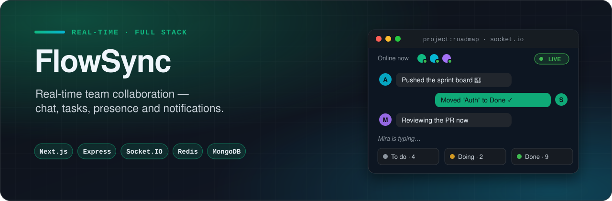
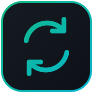
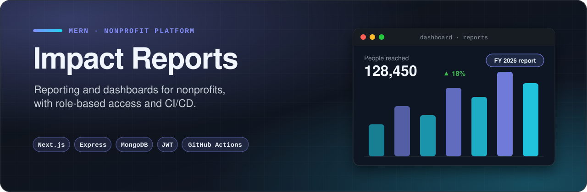
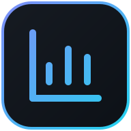
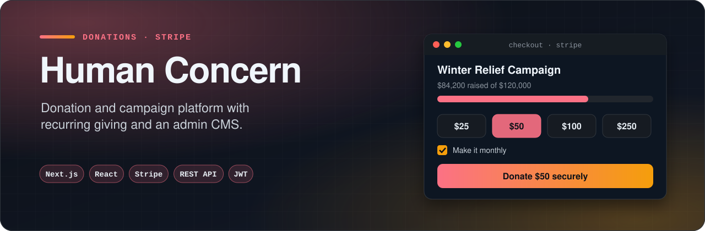
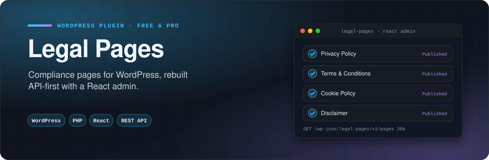
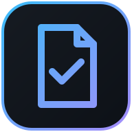
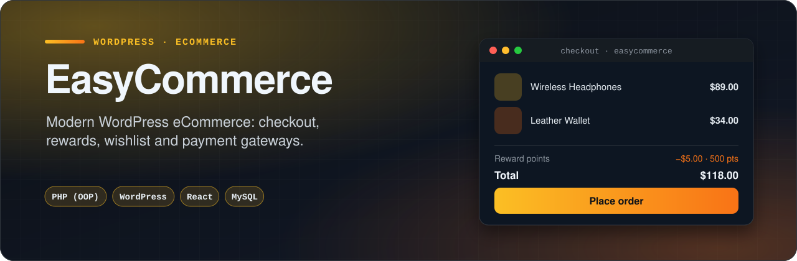

.gif)
# 👋 Hi, I'm Sadekur Rahman

## 💻 About Me
I'm a **Software Engineer** with over **4** years of experience building scalable web applications, WordPress products, and full-stack solutions.

My expertise spans **WordPress plugin development, MySQL, React.js, Next.js, Node.js, MongoDB, and modern API-driven architectures**. I enjoy designing clean, maintainable systems that solve real-world business problems, whether that's a **WordPress plugin, a SaaS platform, an eCommerce solution, or a dashboard-driven web application**.

Currently, I work at **Progressive Byte**, where I develop both **WordPress** products and full-stack applications, including **MERN**-based platforms, payment integrations, authentication systems, admin dashboards, and CI/CD deployment pipelines.

I am passionate about continuous learning, software architecture, clean code, and building products that deliver measurable value to users and businesses.

  

  

## 🚀 Skills

### 🌟 Key Specializations
- **Full-Stack Web Development**
- **WordPress Plugin Development** (Custom, modular & scalable)
- **React.js & Next.js Applications**
- **MERN Stack Development**
- **REST API & Third-Party Integrations**
- **Authentication & Authorization Systems**
- **Payment Gateway Integration (as like Stripe, PayPal)**
- **CI/CD & VPS Deployment**
- **Dashboard & SaaS Application Development**
- **Headless WordPress Solutions**

---

### 🛠️ Technical Stack

| Category | Technologies |
|--------|-------------|
| **Frontend** | HTML5, CSS3, Tailwind CSS, JavaScript (ES6+), React.js, Next.js |
| **Backend** | PHP (OOP), Node.js (Express.js) |
| **Database** | MySQL, MongoDB |
| **CMS** | WordPress (Plugin & Theme Development), Headless WordPress |
| **APIs** | REST APIs, JWT Authentication |
| **DevOps** | GitHub Actions, CI/CD, PM2, VPS Deployment |
| **Tools** | Git, GitHub, Bitbucket, Postman, Webpack, Babel, npm |
| **Environment** | Linux |

---

## 📦 Featured Projects

### 🔄 [FlowSync](https://github.com/sadekur/flowSync) — Real-Time Team Collaboration Platform

  

<table>
  <tr>
    <td width="120" align="center" valign="middle">
      
    </td>
    <td valign="middle">
      

        A <b>real-time team collaboration platform</b>: workspaces, projects and tasks, with live
        <b>chat, typing indicators, online presence and notifications</b> on top. Built with
        <b>Next.js (App Router) + Express + Socket.IO</b>, MongoDB for data and Redis for everything shared.
      

      

        Auth is <b>JWT in httpOnly cookies</b> with double-submit <b>CSRF</b> protection, and the same cookie
        authenticates the Socket.IO handshake. Membership is re-checked on <b>every</b> socket write, presence and
        rate limits live in <b>Redis</b>, and the <b>Socket.IO Redis adapter</b> lets any number of backend
        instances run side by side. Covered by <b>113 Vitest tests</b>, including reconnect tests that drive the
        real Redux store against the real server.
      

      

        
        
        
      

      

        
        
        
        
        
        
        
        
      

    </td>
  </tr>
</table>

 

### 📊 [Impact Reports](https://impact.humanconcernusa.org/) — Reporting Platform for Nonprofits

  

<table>
  <tr>
    <td width="120" align="center" valign="middle">
      
    </td>
    <td valign="middle">
      

        A full-stack <b>MERN platform for nonprofit organizations</b> featuring <b>role-based authentication</b>,
        dashboard systems, report management and REST APIs.
      

      

        Shipped with an automated <b>CI/CD pipeline</b> (GitHub Actions) and <b>PM2</b>-managed deployment.
      

      

        
      

      

        
        
        
        
        
        
        
      

    </td>
  </tr>
</table>

 

### ❤️ [Human Concern Donation Platform](https://human-concern-frontend.vercel.app/) — Donations & Campaigns

  

<table>
  <tr>
    <td width="120" align="center" valign="middle">
      
    </td>
    <td valign="middle">
      

        A <b>donation and campaign management platform</b> with <b>Stripe</b> integration and
        <b>recurring donations</b>.
      

      

        Includes user dashboards, admin <b>CMS modules</b> and API-driven workflows behind JWT authentication.
      

      

        
      

      

        
        
        
        
        
      

    </td>
  </tr>
</table>

 

### ⚖️ [Legal Pages (Free & Pro)](https://wordpress.org/plugins/legal-pages/) — WordPress Compliance Plugin

  

<table>
  <tr>
    <td width="120" align="center" valign="middle">
      
    </td>
    <td valign="middle">
      

        <b>Re-developed the plugin</b> using a modern <b>API-driven architecture</b> with a
        <b>React-based admin interface</b>.
      

      

        The rebuild improved scalability and made compliance-page management easier for site owners.
      

      

        
      

      

        
        
        
        
      

    </td>
  </tr>
</table>

 

### 🛒 [EasyCommerce](https://easycommerce.dev/) — Modern WordPress eCommerce

  

<table>
  <tr>
    <td width="120" align="center" valign="middle">
      
    </td>
    <td valign="middle">
      

        A modern <b>WordPress eCommerce solution</b> where I contribute to both frontend and backend features.
      

      

        My work includes the <b>addons architecture</b>, <b>checkout customization</b>, order management, a
        <b>points &amp; rewards system</b>, wishlist, <b>payment gateways</b> and API-based integrations.
      

      

        
        
      

      

        
        
        
        
        
      

    </td>
  </tr>
</table>

 

➡️ *More projects available on my GitHub profile.*

---
- 📄 **[Know about my experiences]** [https://drive.google.com/file/d/1X6U2wlR5YTpGtkwwcZlpk5igELwf2Jdb/view?usp=sharing](https://drive.google.com/file/d/1X6U2wlR5YTpGtkwwcZlpk5igELwf2Jdb/view?usp=sharing)

<h3 align="left">Languages and Tools:</h3>

  
  
  
  
  
  
  
       
       
  
  
  
  
  
  
  

---

## 🏆 Problem-Solving & Competitive Programming

  <a href="https://www.codewars.com/users/sadekur" target="_blank" style="text-decoration:none;">
    
     
    <strong>🚀 Codewars Profile</strong>
  </a>

  <a href="https://www.hackerrank.com/shadekur_rahman" target="_blank" style="text-decoration:none;">
    
     
    <strong>💡 HackerRank Profile</strong>
  </a>

  <a href="https://leetcode.com/user0756cG/" target="_blank" style="text-decoration:none;">
    
     
    <strong>🧩 LeetCode Profile</strong>
  </a>

I enjoy sharpening my problem-solving skills and applying algorithmic thinking to real-world development challenges.

---

## 📚 Currently Learning

- **🤖 Agentic AI & AI Agents**
- **🧠 Retrieval-Augmented Generation (RAG)**
- **🗄️ Vector Databases (Pinecone, Chroma, Qdrant)**
- **🏗️ Advanced System Design**
- **☁️ Docker & Containerization**
- **☁️ AWS & Cloud Deployment**
- **⚡ Advanced Next.js Architecture**
- **🔷 TypeScript**
- **🧩 Microservices & Scalable Backend Systems**

---

These technologies are part of my journey to becoming a more versatile developer, capable of tackling diverse challenges in web development and beyond.

---

## 💼 Current Role

### 🏢 Plugin Developer — **Progressive Byte Ltd**

At Progressive Byte, I develop scalable WordPress products and modern full-stack web applications.

My responsibilities include:
- 🧩 **WordPress Plugin Architecture & Development**
- ⚡ **React.js & Next.js Application Development**
- 🎨 **Node.js & REST API Development**
- 🔌 **MongoDB & MySQL Database Design**
- 📦 **Payment System Integration**
- 📦 **VPS Deployment & Server Management**
- 📦 **Performance Optimization & Code Quality**

This role allows me to combine creativity with engineering discipline to ship production-ready solutions.

---

## 🤝 Collaboration & Open Source

- 💬 Open to WordPress, React.js, Next.js, and MERN Stack collaborations 
- 🚀 Interested in open-source contributions and developer tooling
- 🤝 Happy to discuss plugin architecture, APIs, authentication systems, and full-stack development
- 💬 Always excited to build products that solve real-world problems
  
**"Building scalable software, modern web applications, and high-quality WordPress products."** 🚀

---

## 📊 GitHub in Numbers

  
  

  
  

### 📈 Contribution Activity

  

---

## ☕ Support My Work

---

## 🌐 Connect With Me

* 💡 **Stack Overflow:** [stackoverflow.com/users/sadekur-rahman](https://stackoverflow.com/users/sadekur-rahman)
* 🌐 **LinkedIn:** [linkedin.com/in/sadekur-rahman-soikut](https://linkedin.com/in/sadekur-rahman-soikut)
* 🐦 **Twitter:** [twitter.com/rahman_shadekur](https://twitter.com/rahman_shadekur)
* 📂 **GitHub:** [github.com/sadekur](https://github.com/sadekur)
* 💼 **Facebook:** [https://www.facebook.com/shadkur.rahman.soikut/](https://www.facebook.com/shadkur.rahman.soikut/)
* 📺 YouTube: [https://www.youtube.com/c/sadekrrahman7893](https://www.youtube.com/c/sadekrrahman7893)
* 📫 **Gmail:** shadekur.rahman60@gmail.com
* 📍 **Location:** Dhaka, Bangladesh

**“Engineering scalable plugins and modern web applications.” 🚀**
